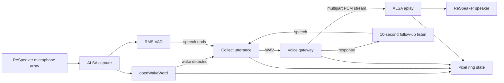

# Orion Satellite POC

The satellite captures 16 kHz mono PCM with ALSA, detects a wake word locally through `openWakeWord`, uses RMS VAD to endpoint an utterance, and streams the resulting WAV to `voice-gateway`. It receives raw PCM response parts and pipes them directly into `aplay` without waiting for a complete audio file. During response playback, it continues local capture and immediately stops `aplay` and closes the HTTP stream when sustained local speech is detected. This is the POC full-duplex interruption path; AEC tuning is still required before it can be considered reliable.

## Architecture

The satellite keeps wake detection, voice activity detection, device LEDs, and audio playback on the local device. It sends only completed utterances to the gateway and receives sentence-sized PCM responses as a multipart stream. If Orion asks a question, the satellite enters a bounded follow-up listening period without requiring another wake word.



Ring states are off while idle, wake/listen during capture, think while the gateway processes a turn, and speak during audio playback. Firmware VAD LEDs are disabled so ambient noise does not drive the visual state.

## Tested Hardware

The current recommended Orion satellite setup is:

- A Raspberry Pi running 64-bit Linux with Docker and Docker Compose.
- A Seeed ReSpeaker 4 Mic Array (UAC1.0), connected directly or through the Pi.
- The ReSpeaker USB audio device for both capture and playback.
- The ReSpeaker USB pixel ring for assistant-state feedback.
- A stable network path to the voice gateway.

The tested ReSpeaker profile uses six input channels, channel `5` for its processed/AEC stream, and channel `0` as a raw-microphone fallback. It uses `plughw:CARD=ArrayUAC10,DEV=0` when explicitly configured. When capture or playback devices are omitted, the satellite detects a ReSpeaker ALSA device automatically.

Other hardware is supported in principle, but small changes might necessary. Use `arecord -l` and `aplay -l` to identify the right ALSA devices; adjust the channel count and selected capture/fallback channels for the array; then recalibrate `ORION_SPEECH_RMS`, `ORION_WAKE_THRESHOLD`, and interruption settings for the room. Pixel-ring controls require the ReSpeaker USB LED interface; disable `ORION_PIXEL_RING` for microphones without it. Speaker echo can make barge-in unreliable unless the selected capture channel provides working AEC.

## Configure

Create `.env` from the committed template and set the reachable gateway address:

```sh
cp .env.example .env
```

The `.env` file is intentionally ignored and must not be committed. Its default values target a ReSpeaker 4 Mic Array and the bundled `hey_jarvis` wake model.

Key configuration values:

```dotenv
ORION_GATEWAY_URL=http://PI_OR_LAN_HOST:8090/voice/v1/turns
ORION_CAPTURE_DEVICE=plughw:CARD=YOUR_RESPEAKER,DEV=0
ORION_PLAYBACK_DEVICE=plughw:CARD=YOUR_SPEAKER,DEV=0
ORION_WAKE_MODEL=/models/hey_orion.tflite
ORION_WAKE_THRESHOLD=0.5
ORION_SPEECH_RMS=450
GAMMAVAD_SR=10
ORION_PLAYBACK_BUFFER_MS=500
ORION_INTERRUPTION_FRAMES=4
```

`GAMMAVAD_SR` is the number of 80 ms silent frames that endpoint speech. The
default is `10` (800 ms). `ORION_PLAYBACK_BUFFER_MS` controls the short PCM
buffer retained before ALSA playback begins. The satellite logs the elapsed time
from the last detected speech frame to the first PCM chunk received and handed to
`aplay` for each response.

`ORION_WAKE_MODEL` must be an `openWakeWord` `.tflite` model placed under `models/`. When it is unset, openWakeWord's packaged model set is used; set a dedicated model before treating a word as the Orion activation phrase.

Discover stable ALSA card identifiers on the Pi using `arecord -l` and `aplay -l`, then use the `CARD=` form above instead of numeric card indexes. Start the satellite with:

```sh
docker compose up --build
```

The container gets only `/dev/snd` and no host network, cloud credential, or raw-audio persistence. Avoid exposing the unauthenticated POC gateway outside your trusted LAN.

Set `ORION_INTERRUPTION_FRAMES` high enough that brief noise does not cancel playback. With the ReSpeaker processed/AEC capture channel, start at four 80 ms frames (320 ms). If speaker playback triggers cancellations, correct the capture channel and AEC route before lowering this setting.