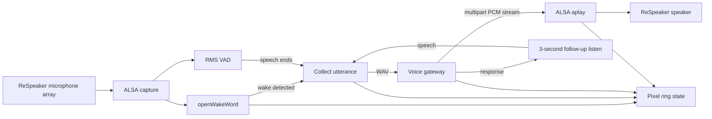

# Orion Satellite POC

The satellite captures 16 kHz mono PCM with ALSA, detects a wake word locally through `openWakeWord`, uses RMS VAD to endpoint an utterance, and streams the resulting WAV to `voice-gateway`. It streams raw PCM response parts to `aplay` and also accepts WAV response parts. When barge-in is enabled, sustained local speech during playback stops `aplay` and closes the HTTP stream. This is a POC interruption path and depends on effective hardware AEC.

## Architecture

The satellite keeps wake detection, voice activity detection, device LEDs, and audio playback on the local device. It sends only completed utterances to the gateway and receives sentence-sized PCM responses as a multipart stream. If Orion asks a question, the satellite enters a bounded follow-up listening period without requiring another wake word.



Ring states are off while idle, wake/listen during capture, think while the gateway processes a turn, and speak during audio playback. The ReSpeaker's native animations use a light and dark blue palette, with a brief spin when playback is interrupted. Firmware VAD LEDs are disabled so ambient noise does not drive the visual state.

## Tested Hardware

The current recommended Orion satellite setup is:

- A Raspberry Pi running 64-bit Linux with Docker and Docker Compose.
- A Seeed ReSpeaker 4 Mic Array (UAC1.0), connected directly or through the Pi.
- The ReSpeaker USB audio device for both capture and playback.
- The ReSpeaker USB pixel ring for assistant-state feedback.
- A stable network path to the voice gateway.

For Seeed's six-channel ReSpeaker firmware, channel `0` is processed speech, channels `1`-`4` are raw microphones, and channel `5` is the playback reference. Use channel `0` for capture and route playback through the ReSpeaker audio output so its hardware DSP can cancel echo. The example uses `plughw:CARD=ArrayUAC10,DEV=0` for both. When capture or playback devices are omitted, the satellite detects a ReSpeaker ALSA device automatically. Verify the channel mapping for other firmware and test actual echo cancellation in the room.

Other hardware is supported in principle, but small changes might necessary. Use `arecord -l` and `aplay -l` to identify the right ALSA devices; adjust the channel count and selected capture/fallback channels for the array; then recalibrate `ORION_SPEECH_RMS`, `ORION_WAKE_THRESHOLD`, and interruption settings for the room. Pixel-ring controls require the ReSpeaker USB LED interface; disable `ORION_PIXEL_RING` for microphones without it. Speaker echo can make barge-in unreliable unless the selected capture channel provides working AEC.

## Configure

Create `.env` from the committed template and set the reachable gateway address:

```sh
cp .env.example .env
```

The `.env` file is intentionally ignored and must not be committed. Its default values target a ReSpeaker 4 Mic Array and the bundled `hey_jarvis` wake model.

Key configuration values:

```dotenv
ORION_GATEWAY_URL=http://PI_OR_LAN_HOST:8090/voice/v1/turns
ORION_CAPTURE_DEVICE=plughw:CARD=YOUR_RESPEAKER,DEV=0
ORION_PLAYBACK_DEVICE=plughw:CARD=YOUR_SPEAKER,DEV=0
ORION_WAKE_MODEL=/models/hey_orion.tflite
ORION_CAPTURE_CHANNELS=6
ORION_CAPTURE_CHANNEL=0
ORION_WAKE_THRESHOLD=0.84
ORION_SPEECH_RMS=450
GAMMAVAD_SR=10
ORION_PLAYBACK_BUFFER_MS=150
ORION_INTERRUPTION_FRAMES=4
ORION_BARGE_IN_ENABLED=true
ORION_FOLLOW_UP_SECONDS=3
ORION_POST_PLAYBACK_SILENCE_FRAMES=4
```

`GAMMAVAD_SR` is the number of 80 ms silent frames that endpoint speech. The
default is `10` (800 ms). `ORION_PLAYBACK_BUFFER_MS` controls the short PCM
buffer retained before ALSA playback begins; a smaller buffer may cause underruns.
After playback, `ORION_POST_PLAYBACK_SILENCE_FRAMES` requires four consecutive
silent 80 ms frames (320 ms) before listening for a follow-up. The follow-up
window then allows three seconds for speech to begin by default. Existing `.env`
values override these defaults. The satellite logs the elapsed time from the last
detected speech frame to the first PCM chunk received and handed to `aplay` for
each response; these are not measurements of audible playback.

`ORION_WAKE_MODEL` must identify an available `openWakeWord` `.tflite` model. When unset, the packaged Hey Rhasspy model is used; the example configuration selects Hey Jarvis. Set a dedicated model before treating Orion as the activation phrase.

For missed wakes, check the startup log for capture-channel fallback and verify the selected channel and microphone processing first. Lowering `ORION_WAKE_THRESHOLD` can improve detection but may increase false wakes; openWakeWord recommends starting its included models at 0.5 and tuning against both intended wakes and background audio. Diagnostic scores are sampled once per second and can miss the peak score.

Discover stable ALSA card identifiers on the Pi using `arecord -l` and `aplay -l`, then use the `CARD=` form above instead of numeric card indexes. Start the satellite with:

```sh
docker compose up --build
```

The container gets only `/dev/snd` and no host network, cloud credential, or raw-audio persistence. Avoid exposing the unauthenticated POC gateway outside your trusted LAN.

Set `ORION_INTERRUPTION_FRAMES` high enough that brief noise does not cancel playback. With the ReSpeaker processed/AEC capture channel, start at four 80 ms frames (320 ms). Test both speech over playback and playback without speech. If speaker playback triggers cancellations, correct the capture channel and AEC route or disable `ORION_BARGE_IN_ENABLED`; RMS-based interruption can also mistake other loud sounds for speech. An interruption stops the response; it does not automatically send the interrupting speech as a new command.
